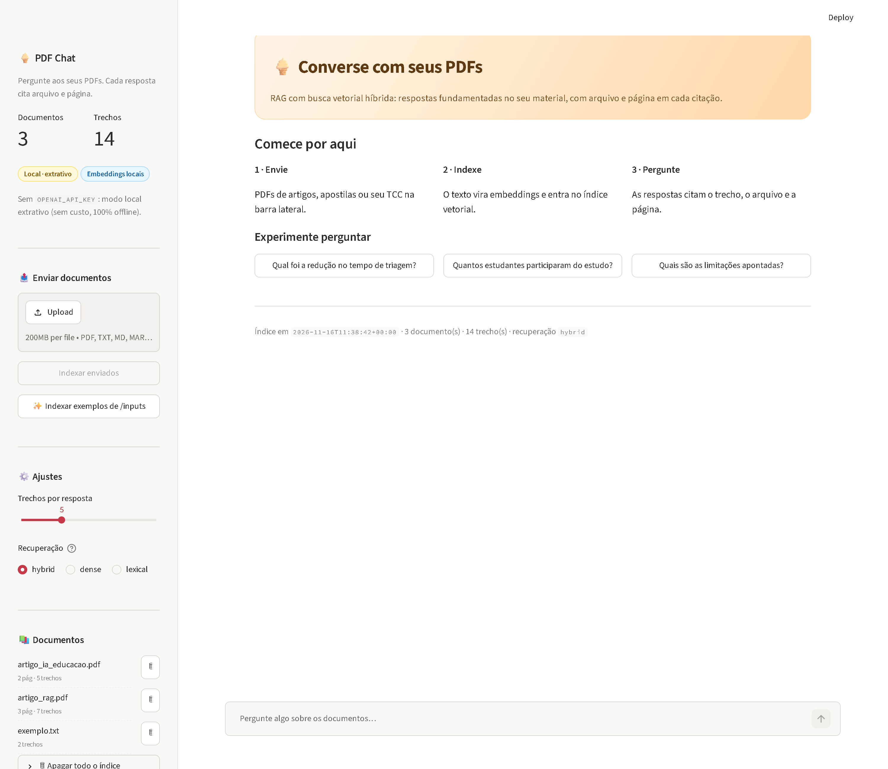
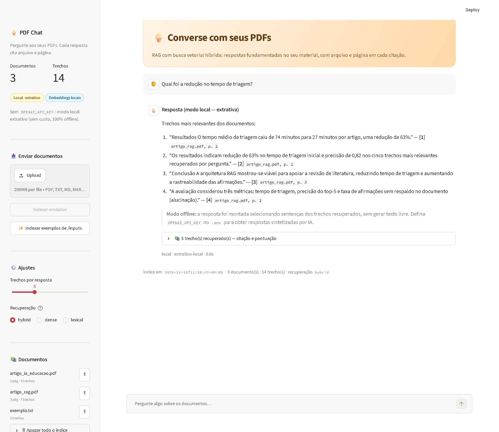
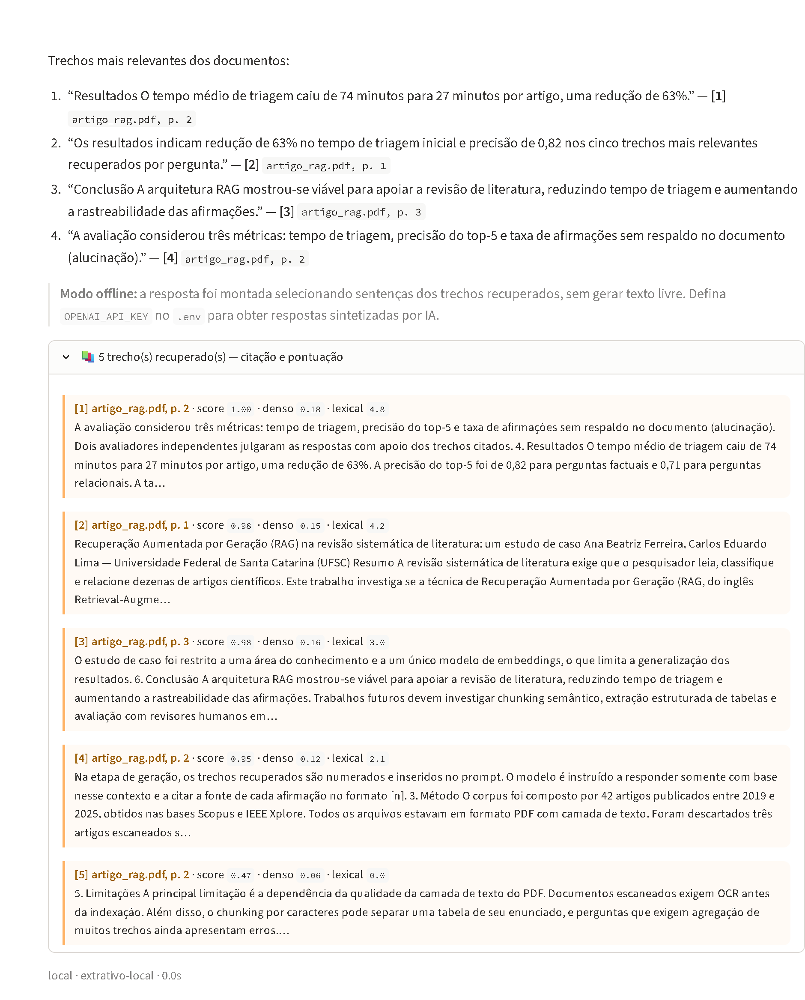

# 🍦 PDF Chat — chatbot com RAG sobre seus PDFs

Chat interativo que responde perguntas **com base no conteúdo dos seus PDFs**, citando **arquivo e página** de cada afirmação. Projeto do desafio **“Criando um Chatbot Baseado em Conteúdo de PDFs”** da [DIO](https://www.dio.me/), com foco em um cenário real: revisar dezenas de artigos científicos para o TCC de Engenharia de Software.

> **Resposta fundamentada, não “achismo” de LLM.** O modelo só vê os trechos recuperados do seu material e é instruído a citar a fonte — e o sistema funciona até **sem chave de API**, 100% offline.


---

## 📸 Demonstração

| Tela inicial | Resposta com fontes |
| --- | --- |
|  |  |

| Trechos recuperados (score + página) | Chat no terminal |
| --- | --- |
|  |  |

---

## 🎯 O problema

Ao escrever o TCC, o estudante acumula artigos em PDF. Localizar “qual artigo fala sobre X”, comparar métodos ou recuperar um número específico vira um trabalho manual e lento. Busca por palavra-chave não entende sinônimos; um chatbot genérico não conhece os documentos e pode **inventar** referências.

A solução é **RAG (Retrieval-Augmented Generation)**:

1. os PDFs são lidos e divididos em trechos;
2. cada trecho vira um vetor (embedding) guardado em um índice;
3. a pergunta é comparada com esses vetores (e com palavras-chave);
4. os melhores trechos são enviados ao modelo, que responde **citando `[n]`**;
5. a interface mostra a fonte, a página e a pontuação de cada trecho.

---

## ✨ Funcionalidades

- 📄 **Upload de PDF, TXT e MD** pela interface web (ou indexação de uma pasta inteira).
- 🔎 **Busca híbrida**: similaridade vetorial (cosseno) + **BM25** lexical, fundidos por **Reciprocal Rank Fusion**.
- 🧠 **Embeddings OpenAI** (`text-embedding-3-small`) quando há chave; **embeddings locais por hashing** (1024 dimensões, sem download) quando não há.
- 💬 **Chat com histórico**, sugestões de perguntas e download da conversa em Markdown.
- 📌 **Citações rastreáveis**: cada resposta aponta arquivo, página, score e o trecho usado.
- 🔁 **Indexação incremental**: arquivos inalterados são ignorados (hash SHA-1); `--rebuild` recria tudo.
- 🧹 **Limpeza de PDF**: remove hifenização de fim de linha, rodapés/cabeçalhos repetidos e páginas vazias.
- 🧯 **Resiliência**: se a API da OpenAI falhar, responde em modo local em vez de quebrar o chat.
- ✅ **19 testes automatizados** cobrindo chunking, embeddings, BM25, índice, ingestão e citação.

---

## 🏗️ Arquitetura

```mermaid
flowchart LR
    A[PDFs / TXT] --> B[Extração por página<br/>pypdf + limpeza]
    B --> C[Chunking<br/>900 chars, overlap 150]
    C --> D[Embeddings<br/>OpenAI ou hashing local]
    D --> E[(Índice vetorial<br/>vectors.npy + JSON)]
    C --> F[(BM25<br/>ranking lexical)]
    Q[Pergunta] --> G[Busca densa]
    Q --> H[Busca lexical]
    E --> G
    F --> H
    G --> I[Fusão RRF]
    H --> I
    I --> J[Prompt com trechos numerados]
    J --> K[LLM OpenAI<br/>ou resposta extrativa]
    K --> L[Resposta + citações [n]<br/>arquivo e página]
```

### Estrutura de pastas

```
.
├── app.py                  # interface Streamlit
├── chat.py                 # atalho para o chat no terminal
├── ingest.py               # atalho para indexar uma pasta
├── make_samples.py         # gera os PDFs de exemplo com reportlab
├── pdfchat/                # pacote com o pipeline
│   ├── config.py           # configuração via .env
│   ├── loaders.py          # extração e limpeza de PDF/TXT
│   ├── chunking.py         # divisão em trechos com sobreposição
│   ├── embeddings.py       # OpenAI + hashing local
│   ├── bm25.py             # ranking lexical
│   ├── store.py            # índice vetorial persistido em disco
│   ├── retriever.py        # busca híbrida com RRF
│   ├── llm.py              # prompt, OpenAI e modo extrativo
│   ├── rag.py              # ChatEngine (ingestão + perguntas)
│   └── cli.py              # interface de terminal
├── inputs/
│   ├── exemplo.txt         # sentenças do desafio
│   └── pdfs/               # 2 artigos de exemplo gerados
├── tests/                  # testes com pytest
└── docs/screenshots/       # prints usados neste README
```

---

## 🚀 Como rodar

### 1. Ambiente

```bash
git clone <url-do-seu-repo>
cd "Criando um Chatbot Baseado em Conteúdo de PDFs"

python -m venv .venv
# Windows (PowerShell):
.\.venv\Scripts\Activate.ps1
# Linux/macOS:
# source .venv/bin/activate

pip install -r requirements.txt
```

### 2. (Opcional) chave da OpenAI

```bash
cp .env.example .env      # no Windows: copy .env.example .env
```

Preencha `OPENAI_API_KEY=` no `.env`. **Sem chave o projeto funciona igual**, só muda a qualidade da redação da resposta (veja [modos](#-modos-de-ia)).

### 3. Indexar os exemplos

```bash
python make_samples.py            # (re)cria os PDFs de exemplo em inputs/pdfs
python ingest.py inputs --rebuild
```

Saída esperada:

```
✓ 3 arquivo(s) indexado(s) · 6 página(s) · 14 trecho(s) (0.3s)
  + exemplo.txt (2 trechos)
  + artigo_ia_educacao.pdf (5 trechos)
  + artigo_rag.pdf (7 trechos)
```

### 4. Conversar

**Interface web (recomendada):**

```bash
streamlit run app.py
```

Abre em `http://localhost:8501`. Você também pode arrastar novos PDFs na barra lateral e clicar em **Indexar enviados**.

**Terminal:**

```bash
python chat.py
# ou uma pergunta única:
python -m pdfchat.cli --ask "Qual foi a redução no tempo de triagem?"
```

Comandos do terminal: `/docs`, `/fontes`, `/top 8`, `/modo hybrid|dense|lexical`, `/limpar`, `/sair`.

---

## 🧪 Exemplos de perguntas (e o que esperar)

Os PDFs de `inputs/pdfs` são artigos fictícios criados para o desafio, com dados verificáveis:

| Pergunta | Resposta esperada | Fonte |
| --- | --- | --- |
| “Qual foi a redução no tempo de triagem?” | 63% (de 74 para 27 minutos por artigo) | `artigo_rag.pdf`, p. 2 |
| “Quantos estudantes participaram do estudo?” | 57 estudantes | `artigo_ia_educacao.pdf`, p. 1 |
| “Quais são as limitações apontadas?” | dependência da camada de texto, tabelas/figuras, corpus restrito | `artigo_rag.pdf`, p. 3 |
| “Por que usar busca híbrida?” | BM25 cobre nomes/siglas/números; RRF combina rankings | `exemplo.txt` |
| “Qual a capital da França?” | “Não encontrei essa informação nos documentos indexados…” | — |

O comportamento da última linha é intencional: **é melhor admitir que não sabe do que alucinar**.

---

## 🧠 Modos de IA

O projeto detecta automaticamente o que está disponível (`PDFCHAT_BACKEND=auto`):

| Componente | Com `OPENAI_API_KEY` | Sem chave (padrão) |
| --- | --- | --- |
| Embeddings | `text-embedding-3-small` (OpenAI) | hashing local de 1024 dimensões (word + bigramas + char 4-grams) |
| Resposta | `gpt-4o-mini` com prompt de citação obrigatória | resposta **extrativa**: seleciona as sentenças mais aderentes de cada trecho |
| Custo | alguns centavos por centenas de perguntas | zero |
| Internet | necessária | não |

O modo local não gera texto livre, mas continua sendo RAG: a resposta é montada a partir dos trechos recuperados, com citação de arquivo e página. É o modo usado nos prints deste README.

Para forçar um comportamento:

```env
PDFCHAT_BACKEND=local      # tudo offline
PDFCHAT_LLM_BACKEND=local  # respostas extrativas, embeddings OpenAI se houver chave
PDFCHAT_EMBED_BACKEND=local
```

Ao trocar o modelo de embeddings, o índice é **recalculado automaticamente** na próxima abertura (sem reler os PDFs).

---

## ⚙️ Configuração (`.env`)

| Variável | Padrão | Descrição |
| --- | --- | --- |
| `OPENAI_API_KEY` | — | habilita LLM + embeddings OpenAI |
| `OPENAI_BASE_URL` | — | endpoint compatível/proxy (opcional) |
| `PDFCHAT_BACKEND` | `auto` | `auto`, `openai` ou `local` |
| `PDFCHAT_LLM_MODEL` | `gpt-4o-mini` | modelo de chat |
| `PDFCHAT_EMBED_MODEL` | `text-embedding-3-small` | modelo de embeddings |
| `PDFCHAT_TEMPERATURE` | `0.2` | criatividade da resposta |
| `PDFCHAT_RETRIEVAL` | `hybrid` | `hybrid`, `dense` ou `lexical` |
| `PDFCHAT_TOP_K` | `5` | trechos enviados ao modelo |
| `PDFCHAT_CHUNK_SIZE` | `900` | tamanho do trecho (caracteres) |
| `PDFCHAT_CHUNK_OVERLAP` | `150` | sobreposição entre trechos |
| `PDFCHAT_EMBEDDING_DIM` | `1024` | dimensão do embedding local |
| `PDFCHAT_MAX_CONTEXT_CHARS` | `7000` | limite de contexto no prompt |
| `PDFCHAT_FALLBACK` | `1` | cai para o modo local se a API falhar |
| `PDFCHAT_INDEX_DIR` | `data/index` | onde o índice é persistido |

---

## 🔬 Decisões técnicas (e por quê)

- **Chunking por sentença com sobreposição** — 900 caracteres cabem bem no contexto e preservam um parágrafo inteiro; 150 de overlap evitam perder uma definição cortada na fronteira.
- **Busca híbrida em vez de só embeddings** — perguntas de revisão misturam conceitos (“alucinação”) e valores exatos (“63%”, “57 estudantes”, “LGPD”). BM25 ganha nos exatos; os embeddings ganham nos sinônimos. O RRF combina os dois sem calibrar escalas.
- **Citação obrigatória `[n]`** — o prompt exige a fonte; a interface mostra o trecho, o arquivo, a página e o score, então o usuário pode conferir em segundos. É o antídoto contra referência inventada.
- **Fallback extrativo** — demonstração e avaliação nunca quebram por falta de chave, rate limit ou internet.
- **Índice em `.npy` + JSON** — zero infraestrutura (sem Chroma/FAISS/pgvector), fácil de versionar/ignorar, didático para quem está aprendendo RAG. A interface `VectorStore` isola a troca por um banco vetorial no futuro.
- **Limpeza de rodapés repetidos** — extrair “Documento de exemplo · p. N” em toda página poluía os embeddings e aparecia nas respostas. Detectar linhas repetidas em ≥50% das páginas melhorou visivelmente a qualidade dos trechos.

---

## ✅ Testes

```bash
pip install -r requirements-dev.txt
python -m pytest
```

```
19 passed
```

Os testes cobrem: limpeza de texto e hifenização, chunking com overlap, determinismo e normalização dos embeddings locais, ranking do BM25, persistência do índice, fusão híbrida, ingestão incremental, remoção de documentos, extração de PDF com página e remoção de rodapé repetido.

---

## 📚 O que aprendi

- **Qualidade do RAG começa na extração.** Nenhum modelo salva um PDF cujos rodapés e quebras de linha viraram ruído. Limpar e remover boilerplate mudou mais o resultado do que trocar o modelo.
- **Chunking é uma decisão de produto.** Trechos pequenos aumentam a precisão da busca, mas perdem contexto; o overlap é o que evita respostas pela metade.
- **Ranking lexical ainda importa.** Siglas, números e nomes próprios são justamente onde embeddings falham mais — o híbrido resolve.
- **Citar é uma feature, não um detalhe.** Mostrar página e trecho transformou a saída em algo verificável, que é o que um trabalho acadêmico exige.
- **Um fallback honesto vale mais que um LLM que inventa.** O modo extrativo deixa claro o que é texto do documento e o que é geração.
- **Streamlit é ótimo para validar rápido**, mas o núcleo do sistema precisa ser independente da UI — daí o pacote `pdfchat` ser usado igual pela web e pelo terminal.

---

## 🧭 Limitações e próximos passos

- PDFs **escaneados** não têm camada de texto: precisam de OCR (ex.: Tesseract) antes da indexação.
- Tabelas e figuras são extraídas como texto corrido; **chunking semântico** e parsers de layout podem melhorar.
- Perguntas que exigem **agregar muitos trechos** (ex.: somar valores de várias tabelas) ainda erram.
- Próximos passos: reranking com cross-encoder, citação clique-para-abrir-na-página, suporte a OCR, avaliação automática (faithfulness/answer relevance), troca do índice por FAISS/pgvector e deploy no Streamlit Community Cloud.

---

## 🗂️ Dados de exemplo

`inputs/exemplo.txt` contém as sentenças do desafio. `inputs/pdfs/*.pdf` são dois artigos fictícios gerados por `make_samples.py` (tema: RAG na revisão de literatura e IA generativa na escrita acadêmica), com números e seções para demonstrar recuperação por página. Substitua-os pelos seus próprios PDFs — o índice é incremental.

---

Feito como parte do desafio da DIO. Se este projeto te ajudou, deixa uma ⭐ no repositório!
